<!--
theme: course
paginate: true
title: The fleet on one screen
style: |
  section { --course: #1d4ed8; }
-->

<!-- _class: lead -->
<!-- _paginate: false -->

# The fleet on one screen

**Session 7** · telemetry, the bridge out of the mesh, and what a production fleet console looks like

Node 4 went dark overnight. How would Edwin have known before a crop did?

<!--
0:00–1:00. Read Edwin's memo. Lab 6 locked the channel and named two gaps it leaves:
noticing a dead node or an attack, and acting on it. Today closes the first: the fleet
reports its own health, the reports leave the mesh for a real dashboard, and we look at
two fleets that run this for a living.
-->

---

<!-- _class: agenda -->

## Today

1. **Watching**: what telemetry is for
2. **Signals**: what each tells; the detection loop
3. **Out of the mesh**: bridge, broker
4. **The dashboard**: red before a node dies
5. **Production**: two real fleets
6. **Lab**: what you'll measure

You'll design a health report, place the bridge in ISO/IEC 30141, time a silent node, and read a production console.

<!--
1:00–2:00. Reading: ISO/IEC 30141 §6.4 (the Usage viewpoint, Table 4) and Figure A.5 for
OMD and RAID.
-->

---

<!-- _class: s1 question -->
<!-- _header: 1 · Watching -->

## Node 4 stops overnight. With the Lab 6 firmware, when does Edwin find out?

1. At once: DTLS reports the lost session
2. When someone next asks it for a reading, or a crop dies
3. When the OTBR notices the node is gone
4. At the next leader election

<!--
2:00–4:30. Answer: B. Nothing in Labs 1–6 reports a node's own state to anyone. A: DTLS
sessions just expire on the server side. C and D: the mesh does notice, and heals
around the node, but tells no human. The smallest thing that would have warned him: a
battery trend and a regular report: telemetry.
-->

---

<!-- _class: s1 figure -->
<!-- _header: 1 · Watching -->

## Business data and telemetry: two audiences, one node

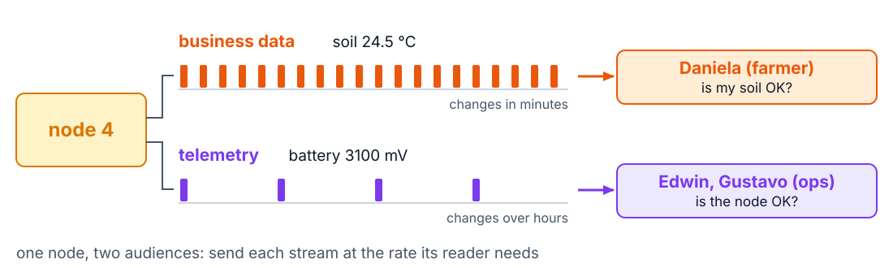

<!--
4:30–6:30. Streaming telemetry at the reading's rate is the classic mistake: twice the
air time for data nobody reads second by second. The engineering, again, is how often
you pay. On the ISO map, the health report is an OMD capability (Operation & Management
Domain); the Usage viewpoint (§6.4) reads it through roles and lifecycle: who watches,
what happens between red and a battery swap. A box and an overlay: don't merge them.
-->

---

<!-- _class: s2 figure -->
<!-- _header: 2 · Signals -->

## What each signal tells an operator

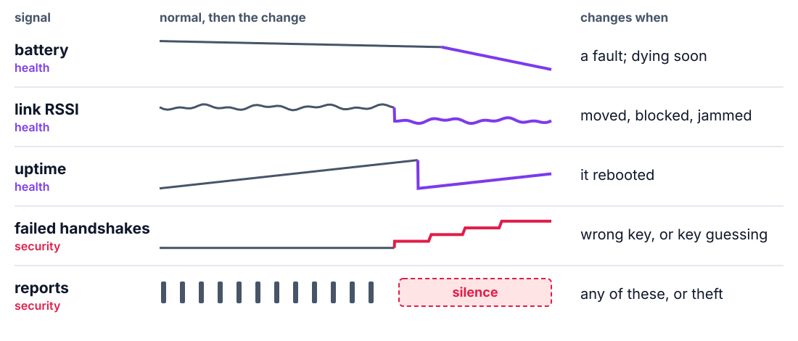

<!--
6:30–9:00. Point at where each trace leaves its normal shape. Three are health signals,
two are security signals, and that is the point: on a fleet, security and reliability
are watched on the same screen. Edwin watching batteries and Edward watching for an
attack read one stream through different thresholds. Uptime is the cheapest reboot
detector there is: it only grows, so any drop is a reset. Failed handshakes come from
the node itself: the firmware counts them by wrapping Mbed TLS's handshake, the Lab 5
technique again. The traces are shapes, not data: students plot their own in the lab.
-->

---

<!-- _class: s2 figure -->
<!-- _header: 2 · Signals -->

## Noticing is a loop, not a feature

<!--
9:00–10:30. Telemetry, a notion of normal, a comparison, an alert. A fixed threshold
catches the obvious; most fleet anomalies are relative: a node that read −60 dBm for a
month and reads −80 today is failing, although −80 is "fine". Compare a node with its
own history and with its neighbours in the same field.
-->

---

<!-- _class: s2 question -->
<!-- _header: 2 · Signals -->

## A node read −60 dBm for a month. Today it reads −80 dBm. The alarm is at −90 dBm. Is it fine?

1. Yes: it is above the alarm
2. No: against its own baseline, it is degrading
3. No: −80 dBm can't carry Thread
4. Only if its battery is fine

<!--
10:30–12:30. Answer: B. A treats the threshold as the definition of healthy. C is false:
Lab 1 measured working links well below −80. D mixes two independent signals. The lab
builds fixed thresholds; the baseline is what production adds on top.
-->

---

<!-- _class: s3 figure -->
<!-- _header: 3 · Out of the mesh -->

## The data leaves the mesh through one component

<!--
12:30–15:00. The bridge terminates the mesh protocol on one side and speaks a broker
protocol on the other: it holds a DTLS session per node, observes /env/temp and
/sys/health, decodes CBOR and publishes JSON. That is RAID's interchange subsystem,
the half Lab 6 left gray, and Table A.3's information fusion that Lab 5's scorecard
deferred. Caution: the OTBR is not the bridge. The OTBR routes opaque IPv6; the bridge
parses and re-encodes. Expect "the nodes already speak IP, why a bridge?": the bridge
reaches them over that very IP path. It exists because the nodes speak CoAP over UDP and
the IT side speaks MQTT or HTTP over TCP, and because one bridge session per node beats
every consumer opening its own to a battery node.
-->

---

<!-- _class: s3 figure -->
<!-- _header: 3 · Out of the mesh -->

## Why a broker, and not every phone to every node

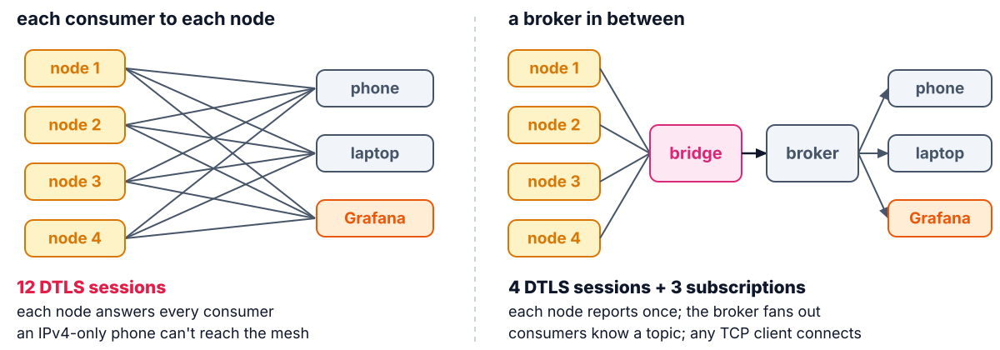

<!--
15:00–17:00. Count the lines on each side. Callback to session 5: an IPv4-only phone
needs 464XLAT or a proxy to reach the mesh, so the industry puts a broker on the access
side. Lab 6 adds one more reason: a node holds only a few DTLS sessions, and every
session costs a battery node RAM and air time. DDR question 2.
-->

---

<!-- _class: s3 figure -->
<!-- _header: 3 · Out of the mesh -->

## The bridge is the architecture; the broker is a setting

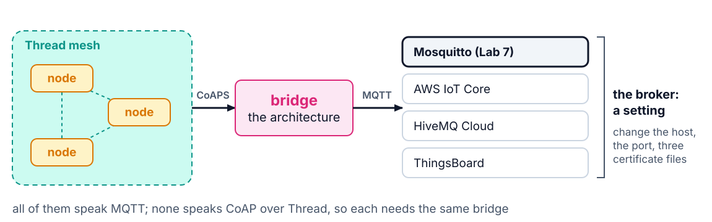

<!--
17:00–18:30. A vendor's "connect your device in one click" hides a bridge like this
one. The lab stack (Mosquitto, Telegraf, InfluxDB, Grafana) is what many operations
teams run themselves; a cloud broker is the optional Task E. Puzzle, no answer: the
mesh is local-first, but visibility now depends on the bridge. Did you just add a
single point of failure, and for what?
-->

---

<!-- _class: s4 figure -->
<!-- _header: 4 · The dashboard -->

## Red before a node dies

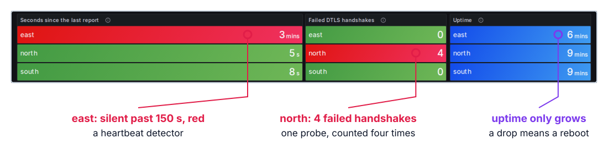

The course bench during the Lab 7 drills.

<!--
18:30–21:00. Three ESP32-C6 nodes: east taken off the network (red after 150 s of
silence), north probed once with a wrong key (one probe counted four times, as the
client retried its last flight). The full dashboard also has the temperature, battery
and RSSI series and a fleet table: open it live if you can. Walk each panel: which
question it answers, for whom. The silence light is a heartbeat detector: a node that
reports every period and hasn't for 150 s is red. Students time their own drills; don't
quote these. Then: this is a lab dashboard. What does one look like when a company's
revenue depends on it?
-->

---

<!-- _class: s5 question -->
<!-- _header: 5 · Production -->

## A truck's engine computers speak J1939 on a CAN bus, never IP. Which part of a telematics system does your bridge's job?

1. The cloud that stores the data
2. The cell tower that carries it
3. The box wired to the engine bus
4. The web portal that shows it

<!--
21:00–23:00. Answer: C, the telematics gateway. A and D sit on the far side of the
broker. B is session 5's misconception again: the cell network, like the OTBR, routes
packets it never parses. The gateway reads J1939 frames and writes messages for the
cloud: it terminates one protocol and speaks another, exactly what the bridge does.
-->

---

<!-- _class: s5 figure -->
<!-- _header: 5 · Production -->

## Same pipeline, three fleets

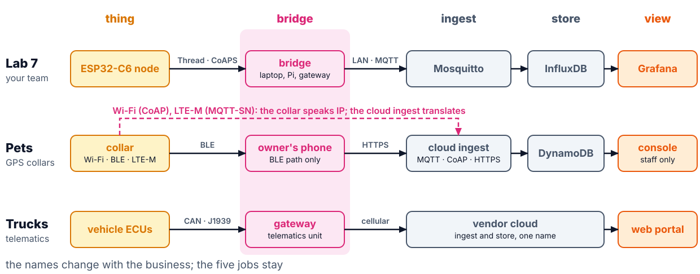

<!--
23:00–24:30. Read the columns, not the rows. Every fleet has a thing, something that
turns its local protocol into Internet messages, a front door, a store and a screen.
The lab runs the bridge on a laptop because that is what you have; a deployed field runs
it on an always-on box: a Raspberry Pi, the border router's Linux host, or a cloud VM
reaching the mesh's routable prefix. The bridge's job is translation, not IP: on Wi-Fi
and LTE-M the collar speaks IP, so nothing local is needed and the cloud ingest
translates; BLE isn't IP, so there the owner's phone does both. The truck vendor keeps
ingest and store behind one name: from outside you see a front door and a portal.
Misconception: "a device that speaks IP needs no bridge". IP gets the packet there;
something still has to turn CoAP into what the store and the screens speak.
-->

---

<!-- _class: s5 figure -->
<!-- _header: 5 · Production -->

## A pet tracker: three paths in, one meaning out

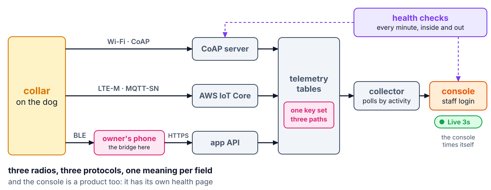

<!--
24:30–27:00. A GPS collar for dogs, in production. It reaches the cloud three ways: CoAP over
Wi-Fi at home (the protocol of Labs 3–6), MQTT-SN over LTE-M when the dog is out, and
BLE through the owner's phone, which is the bridge on that path only. All three must
publish the same keys with the same meaning: once, a "charging" field meant three
different things on the three paths, and the console couldn't be trusted until one rule
was applied on all of them. That is why Lab 7 fixes one CBOR schema.
Live: open the console (staff view, no owner names on the projector). Point at the Live
pill (the console times its own data), last seen per path in the fleet table, one
device page, and the Health page. The collector polls a busy collar every few seconds
and an idle one once a minute: poll rate follows activity, as your report period
should.
-->

---

<!-- _class: s5 question -->
<!-- _header: 5 · Production -->

## A 350 KB upload takes 3 s by FTP over a 150 ms round trip. CoAP sends 1 KB blocks, each waiting for its ACK. How long with CoAP?

1. About 1 s: CoAP's header is 4 bytes
2. About 3 s: the bytes don't change
3. About a minute
4. It can't: CoAP has no files

<!--
27:00–29:00. Let them compute before they vote: 350 blocks, one round trip each,
350 × 0.15 s ≈ 50 s. Answer: C. A is a common field mistake when an upload gets
expensive: a smaller header saves bytes, and bytes weren't the problem. B forgets that every block waits for its ACK. D: block-wise
transfer (RFC 7959) exists to carry files over CoAP; it pays a round trip per block.
-->

---

<!-- _class: s5 figure -->
<!-- _header: 5 · Production -->

## A file upload is round trips plus bytes

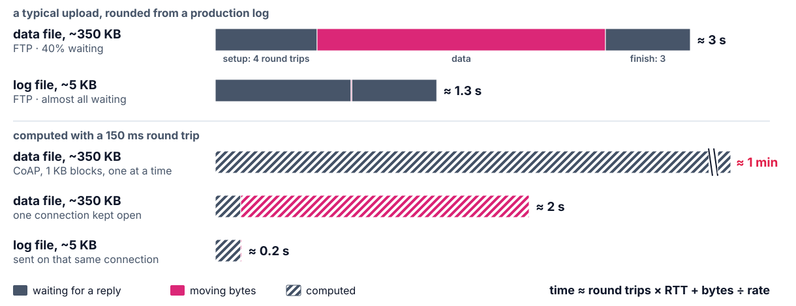

<!--
29:00–31:00. Each file pays a few round trips to set up and a few to finish, around its
bytes, and the radio is on for all of them. Compression shrinks the bytes, not the round
trips, so small files stay almost all waiting. CoAP wins for small messages (one
round trip, no connection) and loses for bulk unless it sends several blocks per round
trip (RFC 9177) or runs over TCP (RFC 8323). The rule: compression cuts the bytes;
batching on one open connection cuts the round trips. Measure the round trip before
you pick a protocol. Your health report is small, so CoAP fits; Lab 8's firmware image
is bulk, and the same arithmetic applies. The top bars are rounded from a production
log; the hatched bars are computed.
-->

---

<!-- _class: s5 figure -->
<!-- _header: 5 · Production -->

## Truck telematics: every alert goes to the person who can act

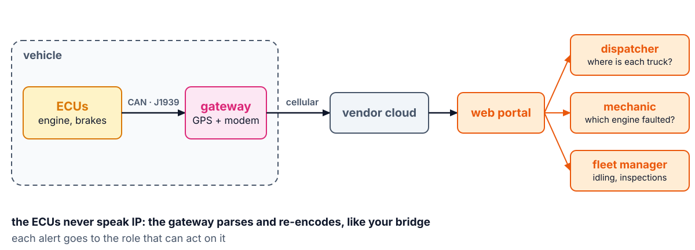

<!--
31:00–33:30. A telematics vendor for trucks, buses and municipal fleets. A vehicle's
computers (engine, transmission, brakes) talk on a CAN bus with J1939, or OBD-II on
light vehicles; they never speak IP. The gateway reads the bus and its own GPS and
sends over cellular. Live: open the portal on a demo account. Point at the map, an
engine fault code, the inspection records. Usage viewpoint (§6.4): each alert names a
role. A fault code goes to the mechanic, a truck off its route to the dispatcher. An
alert that reaches everyone reaches no one. Ask the room: on SoilSense, who gets
"battery low", and who gets "failed handshakes"? (Edwin; Edward.)
-->

---

<!-- _class: s5 figure -->
<!-- _header: 5 · Production -->

## What production adds to your dashboard

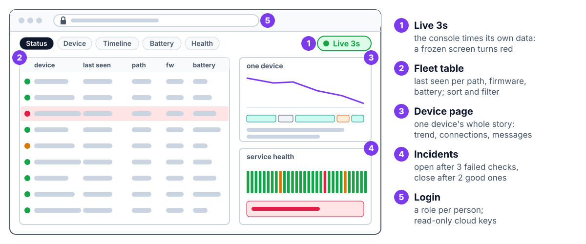

<!--
33:30–35:00. Five things both consoles have that your Grafana board doesn't. 1: a
dashboard that silently stops updating shows a healthy fleet; the pill makes the
console's own silence visible: today's lesson applied to itself. 2 and 3: the fleet
view finds the one device; the device page explains it. 4: hysteresis, as in a
Schmitt trigger: an incident opens after three failed checks in a row and closes after
two good ones, so a flapping service is one incident, not twenty pages at 3 a.m. The
pet tracker also checks itself from outside: a check running on the server can't see the server's
own network go down. 5: people log in, each with a role; the console reads the cloud
with read-only keys. Misconception: more panels look more professional. Production adds
detection of its own failure, drill-down and access control, not colors.
-->

---

<!-- _class: s5 figure -->
<!-- _header: 5 · Production -->

## Watching is not acting

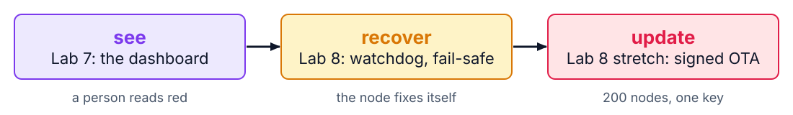

The dashboard tells Edwin which node to visit. It can't fix one, or update 200.

<!--
35:00–35:30. Pillar 3 (watching the system over time) now exists. Pillar 2 (signed code)
is Lab 8's stretch: the same path the telemetry comes up is how an update would go
down. And Samuel's chaos script: the dashboard is how you'll prove recovery happened
without anyone touching a board.
-->

---

<!-- _class: takeaway -->

## The one thing to remember

> Every node reports its own health, and silence is a signal too.

<!--
35:30–36:00. First line of today's DDR entry.
-->

---

<!-- _class: s6 -->
<!-- _header: 6 · Lab -->

## Today in the lab

| You measure | Predict now |
|---|---|
| Bytes of one health report | ____ B |
| Your report period | ____ s |
| Radio-on per day for health, one node | ____ s |
| Silent node → red | ____ s |
| Wrong-key probe → red | ____ s |

Predictions are due before you start the stack.

<!--
36:00–39:00. Teams of four: two pairs, one fleet, one key. Pull the Docker images at
home (setup §7): about 1 GB. The Lab 0 broker holds port 1883: stop it, or move the
stack's broker. Name the nodes on the bridge's command line; the dashboard shows those
names. A failed handshake is counted when the node gives up, so that light lags the
probe: time it anyway.
-->

---

## References

- ISO/IEC 30141:2024 §6.4 (Usage), Figure A.5 (OMD, RAID), Table A.3
- [MQTT 3.1.1](https://docs.oasis-open.org/mqtt/mqtt/v3.1.1/mqtt-v3.1.1.html) · RFC 7641 (Observe) · RFC 7959 and RFC 9177 (block-wise) · SAE J1939
- [Grafana](https://grafana.com/docs/grafana/latest/) · [InfluxDB 2](https://docs.influxdata.com/influxdb/v2/) · [Telegraf](https://docs.influxdata.com/telegraf/v1/)
- [Lab 7](../labs/lab7.md) · [SOP-07](../labs/sops/sop07_fleet.md)

<!--
39:00–40:00. Questions, then the lab.
-->
